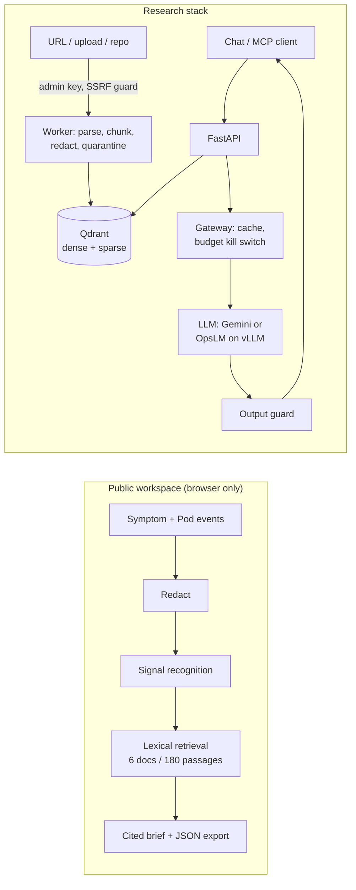

# OpsVerse

**An evaluation-first, security-hardened RAG system for Kubernetes troubleshooting:
hybrid retrieval, a QLoRA fine-tune, measured GPU serving, and a threat model where
every control has a test.**

[Live workspace](https://ops-verse.vercel.app/) ·
[Security](https://ops-verse.vercel.app/security) ([threat model](docs/security/threat-model.md)) ·
[Evidence index](docs/evidence.md) ·
[Engineering case study](https://ops-verse.vercel.app/engineering) ·
[Write-ups](https://dilipna.hashnode.dev)

[](https://github.com/dilipna/OPsVerse/actions/workflows/ci.yml)
[](https://github.com/dilipna/OPsVerse/actions/workflows/eval-gate.yml)

## What it does

Paste a Kubernetes symptom and its Pod events. OpsVerse recognizes the status signals,
retrieves the matching passages from pinned official documentation, and returns an
exportable investigation brief. With the optional model path enabled, a generated answer
is accepted only if every claim cites a retrieved passage and quotes it word for word, and
suggested commands are limited to read-only `kubectl` forms that are never executed.
The public workspace runs entirely in the browser with no account, API key or cluster.

Behind it is a full research stack: ingestion with quarantine and redaction, hybrid
dense + sparse retrieval on Qdrant, a streaming chat API with a degradation ladder, an
MCP server, a fine-tuned model, and a GPU serving benchmark.

## Highlights

| Area | Result | Evidence |
|---|---|---|
| **AI security** | 13 threats mapped to the OWASP LLM Top 10 (2025), each with a control, a rerunnable test and an open-items list | [threat-model.md](docs/security/threat-model.md) |
| | Simple character tricks drop the raw injection detector's recall from 1.00 to 0.00–0.07; scanning normalized text restores 1.00 with no new false positives | [security-robustness-v1](docs/reports/security-robustness-v1.md) |
| | Streaming output guard blocks zero-click exfiltration through rendered Markdown; SSRF guard re-checks every redirect hop | [output_guard.py](libs/security/src/opsverse_security/output_guard.py), [netguard.py](libs/security/src/opsverse_security/netguard.py) |
| **Evaluation rigor** | Pooled, graded golden set (1,914 judgements) with bootstrap CIs and paired permutation tests on every comparison | [retrieval-golden-v1](docs/reports/retrieval-golden-v1.md) |
| | LLM relevance judge audited against human labels (n = 40): it finds about half the relevant material (TPR 0.556) | [judge-validation-v2](docs/reports/judge-validation-v2.md) |
| | Eight of the project's own claims tested and withdrawn, each with the statistic that overturned it | [evidence.md](docs/evidence.md) |
| **Retrieval** | 150-token chunks beat the shipped 350-token default: nDCG +0.044 [+0.019, +0.074], p < 0.001 | [chunking-ablation-v1](docs/reports/chunking-ablation-v1.md) |
| | A 3.1× smaller embedding model is statistically indistinguishable from the incumbent (p = 0.94) | [embedding-ablation-v1](docs/reports/embedding-ablation-v1.md) |
| **Serving** | vLLM FP16 on one T4: 233 tokens/s at concurrency 16, a 13.4× within-engine scaling from c = 1 | [inference-benchmark-v1](docs/reports/inference-benchmark-v1.md) |
| **Fine-tuning** | Qwen3-4B QLoRA (SFT) published as [OpsLM-v1](https://huggingface.co/dhf1234/OpsLM-v1); DPO pipeline built | [ADR-0009](docs/adr/0009-qwen3-4b-qlora-for-opslm.md) |

Every number above links to the committed report that produced it. Scope and caveats for
each are in [docs/limitations.md](docs/limitations.md).

## Security design

The threat model treats four things as untrusted: the user's input, every retrieved
document, the model's output, and every URL the worker is asked to fetch.

| Layer | Control | Where |
|---|---|---|
| Ingest | Credential redaction before storage or embedding; documents carrying instructions aimed at the assistant are quarantined (zero chunks reach retrieval) | `libs/ingestion`, `libs/security` |
| API | Admin key required for ingestion, fail closed outside `dev`; URL fetches pinned to checked public addresses on every hop (no DNS rebinding); per-client rate limits shared through Redis; size caps; admin security-telemetry endpoint with alerts | `apps/api` |
| Prompt | Retrieved text marked as untrusted data; abstain before generation when retrieval fails or finds nothing | `libs/rag/chat.py` |
| Output | Images removed, links only to source and official-doc hosts, credentials redacted, applied to the token stream and again in the renderer | `output_guard.py`, `apps/web` |
| Agency | No tool can change state: MCP tools are read-only; suggested `kubectl` commands are allowlisted and never executed | `apps/mcp-server`, `opslm-demo/lib` |
| Supply chain | Frozen lockfile; blocking `pip-audit` and `npm audit` gates with a reviewed register of accepted advisories; CycloneDX SBOM per CI run; Trivy scan (advisory); gitleaks pre-commit hook | `.github/` |

## Architecture



More detail: [architecture.md](docs/architecture.md) ·
[inference design](docs/inference-design.md) · [22 ADRs](docs/adr/).

## Run it

Needs Python 3.12+ with [uv](https://docs.astral.sh/uv/) and Node 24.

```bash
git clone https://github.com/dilipna/OPsVerse.git && cd OPsVerse
```

```bash
uv sync --all-packages --frozen
```

```bash
uv run pytest -q
```

```bash
uv run python -m opsverse_security.robustness
```

```bash
cd opslm-demo && npm ci && npm test && npm run build && npm start
```

Then open http://localhost:3000. The full local stack (Postgres, Redis, Qdrant, MinIO,
Langfuse) is described in [local-research.md](docs/local-research.md).

## Repository map

```text
apps/api          FastAPI: ingest, search, chat (SSE + WebSocket), evals, costs; arq worker
apps/web          Next.js research console        apps/mcp-server  read-only MCP tools
opslm-demo/       Public workspace (Vercel)       benchmarks/      serving harness + results
libs/security     Injection scan, redaction, output guard, SSRF guard, robustness eval
libs/ingestion    Parsers, chunking, quality gates          libs/rag  hybrid retrieval, chat
libs/evals        Golden set, judge validation, ablations, stats, regression gate
libs/training     SFT/DPO data pipeline           training/        QLoRA and DPO scripts
docs/             Threat model, ADRs, reports, write-ups
```

## License

MIT for this project's code. Kubernetes documentation © The Kubernetes Authors, CC BY 4.0;
attribution and pinned sources are in the [manifest](evalsets/runbooks/manifest.json).
